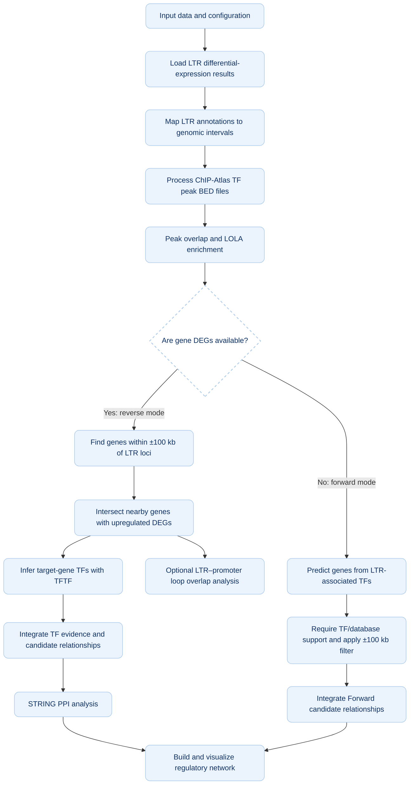

An Integrative R Pipeline for LTR-Mediated Regulatory Network Analysis
XXX is an R package designed to prioritize candidate regulatory relationships involving long terminal repeats (LTRs), integrating mobile element expression, genomic coordinates, transcription factor (TF) evidence, protein–protein interaction (PPI) networks, and three-dimensional (3D) chromatin contact information.
The workflow was developed for a hepatocellular carcinoma (HCC) use case, but is intended to be adaptable to other human disease or tissue datasets when compatible expression, annotation, TF-binding, and chromatin-interaction data are available.
Important interpretation note: This pipeline generates and prioritizes computationally supported hypotheses. An LTR–TF overlap, LOLA enrichment, TFTF prediction, STRING association, or chromatin-loop overlap does not, on its own, prove that an LTR directly regulates a target gene. Candidate relationships require independent biological and experimental validation.
# Contents
- Overview
- Main analytical features
- Workflow
- Repository structure
- Analysis modes
- Required inputs
- Key parameters and definitions
- Software and dependencies
- Running the workflow
- Expected outputs
- Reproducibility and data-quality checks
- Limitations and interpretation
- Troubleshooting
- Data resources
- Citation
- License
## Overview
LTRs are a class of repetitive genomic elements derived from LTR retrotransposons and also include sequences related to endogenous retroviruses. Although many copies are no longer active as mobile elements, their sequences may still retain regulatory potential and may overlap with promoters, enhancers, or TF-bound chromatin regions. Under pathological conditions such as cancer, or under specific physiological conditions, some LTRs can become aberrantly activated and expressed, thereby exerting or unmasking their latent regulatory functions. Therefore, aberrantly expressed LTRs can serve as clues for identifying genomic regions that may participate in host gene regulation.
Traditional LTR analyses often focus on differential expression or linear genomic proximity to nearby genes. This pipeline brings several evidence types into one analysis framework:
1. LTR differential-expression results identify upregulated LTR subfamilies or families.
2. Genomic interval processing maps selected LTR annotations to candidate loci in the reference genome.
3. ChIP-Atlas and LOLA analyses identify TF-associated peak overlaps and TF sets enriched in candidate LTR regions.
4. Target-gene obtaining uses either a DEG-dependent reverse strategy or a DEG-independent forward strategy.
5. TFTF-based inference integrates gene–TF regulatory evidence from multiple resources.
6. STRING PPI integration identifies known or predicted protein associations that may connect LTR-associated TFs with TFs associated with candidate target genes.
7. Network construction and visualization combine the supported computational relationships into an interpretable graph.
8. Three-dimensional chromatin-loop analysis tests whether a candidate LTR interval and target-gene promoter overlap opposite anchors of the same loop.
## Main analytical features
 LTR-focused downstream analysis of TEtranscripts differential-expression results.
 Genomic interval handling with GenomicRanges and compatible genome annotations.
 ChIP-Atlas peak processing and locus-level overlap examination.
 LOLA enrichment of TF-associated peak sets against a defined LTR-region universe.
 A configurable ±100 kb genomic search window for candidate cis-proximal genes.
 Two complementary target-identification modes:
  Reverse mode: candidate LTR loci → nearby upregulated DEGs → gene-associated TF inference.
  Forward mode: LTR-associated TFs → predicted TF target genes → restriction to genes in the ±100 kb LTR window.
 Multi-resource TF evidence integration using TFTF-supported predictions.
 STRING-based PPI bridging and network visualization.
 Hi-C/loop anchor overlap to add three-dimensional spatial evidence.
## Workflow
The following diagram summarizes the intended analysis logic.

## Conceptual network layers
In reverse mode, the intended network is:
Upregulated LTR locus → LTR-associated TF → PPI-associated TF bridge → target-gene-associated TF → candidate target gene
In forward mode, the network is shorter because a DEG-dependent gene-side TF analysis is not required:
Upregulated LTR locus → LTR-associated TF → predicted target gene within the ±100 kb window
The arrows represent computationally inferred or integrated relationships. They should not be interpreted as experimentally demonstrated causal steps unless supported by additional evidence.
## Required inputs
| Input | Purpose | Important checks |
|---|---|---|
| TEtranscripts differential-expression output | Identifies differentially expressed TE/LTR families or subfamilies. | Keep the family/subfamily identifier, fold change, adjusted p-value, and any expression statistics needed by the script. |
| Gene differential-expression table (reverse mode) | Filters LTR-proximal genes to upregulated DEGs. | Include a consistent gene identifier, `log2FoldChange` (or equivalent), and adjusted p-value. Match identifiers to the gene annotation used later. |
| TE/LTR genome annotation | Maps TE family/subfamily annotations to genomic insertion coordinates. | Use an annotation compatible with the selected reference build and the identifiers in the TEtranscripts output. |
| Gene annotation | Supplies gene spans, gene names/IDs, and transcription start sites (TSSs). | Ensure gene IDs are harmonized across DEG, TFTF, and promoter tables. |
| ChIP-Atlas TF peak BED files | Provides TF-associated peak regions for overlap and enrichment. | Confirm genome assembly, chromosome naming, BED coordinate convention, TF/sample metadata, and the origin of each experiment. |
| LOLA region database/background | Defines the reference region sets used for enrichment testing. | Use a relevant background universe and keep it consistent with the target region set and genome build. |
| TFTF-compatible regulatory resources | Supports gene–TF prediction from multiple resources. | Check resource availability, database versions, organism, gene-ID mapping, and the number of supporting databases reported by the installed version. |
| STRING access or interaction data | Connects proteins/TFs by known or predicted associations. | STRING queries may require a working internet connection. Use consistent human gene/protein identifiers. |
| Chromatin-loop data in BEDPE or a compatible format | Tests whether LTRs and target promoters overlap opposite loop anchors. | Confirm anchor columns, chromosome naming, coordinate build, and whether the data represent the tissue/cell model relevant to the question. |

## Key parameters and definitions
The values below reflect the analysis design described for this workflow.

| Parameter | Analysis definition described in the study | Why it matters |
|---|---|---|
| LTR differential-expression threshold | `log2FoldChange > 0.585` and adjusted `p < 0.05` for upregulated LTRs | Selects LTR families/subfamilies for downstream locus analysis. The threshold is equivalent to a fold change greater than approximately 1.5 on the linear scale. |
| Upregulated DEG threshold (reverse mode) | `log2FoldChange > 0.585` and adjusted `p < 0.05` | Focuses the reverse-mode list on nearby genes with increased expression in the case group. |
| LTR-proximal gene window | ±100 kb around each candidate LTR locus | A heuristic search window for candidate cis-proximal genes; not a demonstrated enhancer range. |
| Gene promoter window for loop checks | 2,000 bp upstream and 500 bp downstream of the TSS, interpreted with gene strand | Defines the promoter interval compared with chromatin-loop anchors. |
| LOLA significance | Fisher's exact test/enrichment statistics, with adjusted significance reported using `q < 0.05` in the study description | Prioritizes TF-associated region sets enriched in the candidate LTR regions. Check the current code for any additional overlap, p-value, odds-ratio, or support-count filters. |
| Reverse-mode gene–TF support | At least 8 independent regulatory resources (`Hit_DB_Count ≥ 8`) in the described analysis | Selects strongly cross-supported candidate TF–gene relationships. |
| Forward-mode TF support | At least 2 distinct LTR-associated TFs and at least 6 independent regulatory resources in the described analysis | Reduces predictions with weak or single-source support before the proximity filter. |
| STRING confidence | Score threshold around `700` (equivalent to `0.700` on a 0–1 scale) in the described analysis | Restricts PPI bridging to higher-confidence protein associations. |

## LOLA background and filtering
The enrichment background is especially important: a background containing all genomic regions can answer a different question from one containing only expressed/eligible LTR loci. The described workflow uses an eligible LTR-region universe for LTR enrichment rather than treating every genomic interval as equally testable.
## Software and dependencies
| Dependency / Package | Verified Version | Type / Source | Main Role & Pipeline Assessment |
| :--- | :---: | :---: | :--- |
| **R Runtime** | `4.4.3` | Language Base | Primary R runtime and execution environment. |
| **GenomicRanges** | `1.58.0` | Bioconductor | Formats, holds, and manipulates interval coordinates (`GRanges`) for LTRs, genes, and loops . |
| **rtracklayer** | `1.66.0` | Bioconductor | Imports and exports BED, BEDPE, and GFF/GTF annotations into R, handling coordinate builds correctly . |
| **DESeq2** | `1.46.0` | Bioconductor | Processes LTR subfamily-level and gene-level count matrices to evaluate differential expression . |
| **LOLA** | `1.36.0` | Bioconductor | Performs Locus Overlap Analysis to test enrichment of ChIP-Atlas TF-binding sets within candidate LTRs . |
| **clusterProfiler** | `4.14.6` | Bioconductor | Conducts functional enrichment analyses and handles ID conversions for identified candidate target genes. |
| **biomaRt** | `2.62.1` | Bioconductor | Connects to BioMart databases for online genomic annotation retrieval and ID mapping. |
| **STRINGdb** | `2.18.0` | Bioconductor/CRAN | Connects locally to the STRING database to fetch and map Protein-Protein Interaction (PPI) networks . |
| **org.Hs.eg.db** | `3.20.0` | Bioconductor | Genome-wide annotation for Human, enabling seamless mapping of diverse gene IDs (Ensembl, Symbol, Entrez). |
| **TxDb.Hsapiens.UCSC.hg38.knownGene** | `3.20.0` | Bioconductor | Coordinates UCSC hg38 gene models, exon/intron boundaries, and transcription start sites (TSS). |
| **GenomeInfoDb** | `1.42.3` | Bioconductor | Synchronizes chromosome naming styles (e.g., "chr1" vs "1") across diverse input multi-omics tables. |
| **IRanges** | `2.40.1` | Bioconductor | Serves as the fundamental non-genomic interval calculator supporting `GenomicRanges`. |
| **tidyverse** | `2.0.0` | CRAN | Collection of essential packages (`ggplot2`, `dplyr`, `tidyr`, `readr`, `stringr`, etc.) for data import, tidying, and visualization. |
| **dplyr** | `1.2.1` | CRAN | Fast data frame manipulation, filtering, merging, and summary statistics. |
| **stringr** | `1.6.0` | CRAN | Pattern matching and robust string manipulation for element naming . |
| **readr** | `2.2.0` | CRAN | High-speed, robust parsing of flat input CSV/TSV matrices. |
| **readxl** | `1.4.5` | CRAN | Imports data directly from Excel formats without manual formatting. |
| **igraph** | `2.3.1` | CRAN | Builds, validates, analyzes (centrality/hubs), and exports LTR-TF-TF-Gene topological graphs . |
| **ggforce** | `0.5.0` | CRAN | Visualizes topological graph networks with complex shapes and zoom/clipping features . |
| **ggplot2** | `4.0.3` | CRAN | Generates visual diagnostics, volcano plots, and data-rich summary figures. |
| **TFTF** | *latest* | GitHub (`WangJin93/TFTF`) | Custom biologist-created pkg to interrogate trans-regulatory interactions across 9 databases . |
| **TEtranscripts** | `>= 2.2.4` | Python / CLI | Standalone pipeline for quantification of raw RNA-seq reads map back to TEs (optional pre-processing). |
| **libcurl / libxml2 / libssl / libgsl** | *(OS native)* | OS Libraries | Underlies parsing, network-fetching, and math (install on Linux/CentOS using `apt-get` or `yum` if packages fail). |
