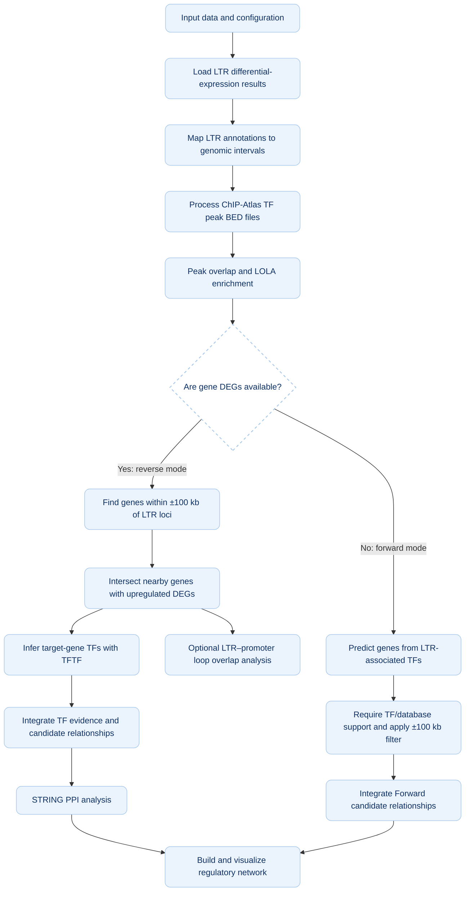

# An Integrative R Pipeline for LTR-Mediated Regulatory Network Analysis  

LTRnet is an R package designed to prioritize candidate regulatory relationships involving long terminal repeats (LTRs), integrating mobile element expression, genomic coordinates, transcription factor (TF) evidence, protein–protein interaction (PPI) networks, and three-dimensional (3D) chromatin contact information.  

The workflow was developed for a hepatocellular carcinoma (HCC) use case, but is intended to be adaptable to other human disease or tissue datasets when compatible expression, annotation, TF-binding, and chromatin-interaction data are available.  

Important interpretation note: This pipeline generates and prioritizes computationally supported hypotheses. An LTR–TF overlap, LOLA enrichment, TFTF prediction, STRING association, or chromatin-loop overlap does not, on its own, prove that an LTR directly regulates a target gene. Candidate relationships require independent biological and experimental validation.
# Contents
- Overview
- Main analytical features
- Workflow
- Conceptual network layers
- Required inputs
- Key parameters and definitions
- LOLA background and filtering
- Software and dependencies
- Running the workflow (Quick Start)
- Expected outputs
- Installation
- Troubleshooting
- Data resources
- Citation
- License
## Overview
LTRs are a class of repetitive genomic elements derived from LTR retrotransposons and also include sequences related to endogenous retroviruses. Although many copies are no longer active as mobile elements, their sequences may still retain regulatory potential and may overlap with promoters, enhancers, or TF-bound chromatin regions. Under pathological conditions such as cancer, or under specific physiological conditions, some LTRs can become aberrantly activated and expressed, thereby exerting or unmasking their latent regulatory functions. Therefore, aberrantly expressed LTRs can serve as clues for identifying genomic regions that may participate in host gene regulation.
Traditional LTR analyses often focus on differential expression or linear genomic proximity to nearby genes. This pipeline brings several evidence types into one analysis framework:
1. LTR differential-expression results identify upregulated LTR subfamilies or families.
2. Genomic interval processing maps selected LTR annotations to candidate loci in the reference genome.
3. ChIP-Atlas and LOLA analyses identify TF-associated peak overlaps and TF sets enriched in candidate LTR regions.
4. Target-gene obtaining uses either a DEG-dependent reverse strategy or a DEG-independent forward strategy.
5. TFTF-based inference integrates gene–TF regulatory evidence from multiple resources.
6. STRING PPI integration identifies known or predicted protein associations that may connect LTR-associated TFs with TFs associated with candidate target genes.
7. Network construction and visualization combine the supported computational relationships into an interpretable graph.
8. Three-dimensional chromatin-loop analysis tests whether a candidate LTR interval and target-gene promoter overlap opposite anchors of the same loop.
## Main analytical features
 LTR-focused downstream analysis of TEtranscripts differential-expression results.
 Genomic interval handling with GenomicRanges and compatible genome annotations.
 ChIP-Atlas peak processing and locus-level overlap examination.
 LOLA enrichment of TF-associated peak sets against a defined LTR-region universe.
 A configurable ±100 kb genomic search window for candidate cis-proximal genes.
 Two complementary target-identification modes:
  Reverse mode: candidate LTR loci → nearby upregulated DEGs → gene-associated TF inference.
  Forward mode: LTR-associated TFs → predicted TF target genes → restriction to genes in the ±100 kb LTR window.
 Multi-resource TF evidence integration using TFTF-supported predictions.
 STRING-based PPI bridging and network visualization.
 Hi-C/loop anchor overlap to add three-dimensional spatial evidence.
## Workflow
The following diagram summarizes the intended analysis logic.

## Conceptual network layers
In reverse mode, the intended network is:
Upregulated LTR locus → LTR-associated TF → PPI-associated TF bridge → target-gene-associated TF → candidate target gene
In forward mode, the network is shorter because a DEG-dependent gene-side TF analysis is not required:
Upregulated LTR locus → LTR-associated TF → predicted target gene within the ±100 kb window
The arrows represent computationally inferred or integrated relationships. They should not be interpreted as experimentally demonstrated causal steps unless supported by additional evidence.
## Required inputs

`LTRnet` is designed to minimize data formatting burdens. Only a few standard output files from upstream tools are required. The corresponding argument names in `run_LTR_pipeline()` are listed below.

| Input Parameter | File Description & Purpose | Important Checks |
|---|---|---|
| **`te_file`** | **TEtranscripts differential-expression output:** Identifies differentially expressed TE/LTR families. | Keep the family/subfamily identifier, fold change, adjusted p-value columns. |
| **`rmsk_file`** | **TE/LTR genome annotation (GTF/GFF):** Maps TE subfamilies to genomic coordinates (e.g., RepeatMasker). | Use an annotation compatible with your selected reference build (e.g., hg38). |
| **`chip_file`** | **ChIP-Atlas TF peak file (BED or RDS):** Provides TF-associated peak regions for overlap and enrichment. | Confirm genome assembly matches your RMSK file. Both `.bed` and serialized `.rds` formats are supported. |
| **`deg_file`** | **Gene differential-expression table (Required for Reverse Mode only):** Filters LTR-proximal genes to actual DEGs. | Include a consistent gene identifier (Symbol), `log2FoldChange`, and adjusted p-value (`padj`). |
| **`hic_bedpe`** | **Chromatin-loop data (Optional):** Tests whether LTRs and target promoters overlap opposite loop anchors (Step 13). | Confirm anchor columns, chromosome naming, and coordinate build. Must be in BEDPE format. |
| **`txdb_pkg`** | **Host Gene Annotation Package (Parameter):** Supplies gene spans and TSS coordinates automatically. | Defaults to `"TxDb.Hsapiens.UCSC.hg38.knownGene"`. Change this parameter for other species (e.g., mm10 for mouse). |

## Key parameters and definitions
While you can view the complete list of all adjustable parameters and their code syntax in R by running `?run_LTR_pipeline`, the table below highlights the most critical biological thresholds used in the workflow and explains the rationale behind them:
| Core Parameter | Default Value | Biological Rationale & Why it matters |
|---|---|---|
| **LTR / DEG log2FoldChange** | `0.585` | Selects LTR families and host genes with a fold change greater than ~1.5 on the linear scale. |
| **LTR-proximal window** | `100` (kb) | A heuristic cis-regulatory search window (±100 kb) around each candidate LTR locus to identify potential target genes. |
| **TFTF support count (Reverse)** | `8` (databases) | Selects strongly cross-supported candidate TF–gene relationships by requiring evidence from at least 8 independent regulatory resources. |
| **STRING PPI confidence** | `700` | Restricts protein-protein bridging to higher-confidence (score ≥ 0.700) experimental or predicted protein associations. |
| **Loop promoter window** | `-2000 to +500` (bp) | Defines the promoter interval around the Transcription Start Site (TSS) to be compared with 3D chromatin-loop anchors. |  

*(Note: To easily override any of these defaults, use the `custom_config` argument in the main function as shown in the Customizing Parameters section below.)*

## LOLA background and filtering
The enrichment background is especially important: a background containing all genomic regions can answer a different question from one containing only expressed/eligible LTR loci. The described workflow uses an eligible LTR-region universe for LTR enrichment rather than treating every genomic interval as equally testable.
## Software and dependencies
| Dependency / Package | Verified Version | Type / Source | Main Role & Pipeline Assessment |
| :--- | :---: | :---: | :--- |
| **R Runtime** | `4.4.3` | Language Base | Primary R runtime and execution environment. |
| **GenomicRanges** | `1.58.0` | Bioconductor | Formats, holds, and manipulates interval coordinates (`GRanges`) for LTRs, genes, and loops . |
| **rtracklayer** | `1.66.0` | Bioconductor | Imports and exports BED, BEDPE, and GFF/GTF annotations into R, handling coordinate builds correctly . |
| **DESeq2** | `1.46.0` | Bioconductor | Processes LTR subfamily-level and gene-level count matrices to evaluate differential expression . |
| **LOLA** | `1.36.0` | Bioconductor | Performs Locus Overlap Analysis to test enrichment of ChIP-Atlas TF-binding sets within candidate LTRs . |
| **clusterProfiler** | `4.14.6` | Bioconductor | Conducts functional enrichment analyses and handles ID conversions for identified candidate target genes. |
| **biomaRt** | `2.62.1` | Bioconductor | Connects to BioMart databases for online genomic annotation retrieval and ID mapping. |
| **STRINGdb** | `2.18.0` | Bioconductor/CRAN | Connects locally to the STRING database to fetch and map Protein-Protein Interaction (PPI) networks . |
| **org.Hs.eg.db** | `3.20.0` | Bioconductor | Genome-wide annotation for Human, enabling seamless mapping of diverse gene IDs (Ensembl, Symbol, Entrez). |
| **TxDb.Hsapiens.UCSC.hg38.knownGene** | `3.20.0` | Bioconductor | Coordinates UCSC hg38 gene models, exon/intron boundaries, and transcription start sites (TSS). |
| **GenomeInfoDb** | `1.42.3` | Bioconductor | Synchronizes chromosome naming styles (e.g., "chr1" vs "1") across diverse input multi-omics tables. |
| **IRanges** | `2.40.1` | Bioconductor | Serves as the fundamental non-genomic interval calculator supporting `GenomicRanges`. |
| **tidyverse** | `2.0.0` | CRAN | Collection of essential packages (`ggplot2`, `dplyr`, `tidyr`, `readr`, `stringr`, etc.) for data import, tidying, and visualization. |
| **dplyr** | `1.2.1` | CRAN | Fast data frame manipulation, filtering, merging, and summary statistics. |
| **stringr** | `1.6.0` | CRAN | Pattern matching and robust string manipulation for element naming . |
| **readr** | `2.2.0` | CRAN | High-speed, robust parsing of flat input CSV/TSV matrices. |
| **readxl** | `1.4.5` | CRAN | Imports data directly from Excel formats without manual formatting. |
| **igraph** | `2.3.1` | CRAN | Builds, validates, analyzes (centrality/hubs), and exports LTR-TF-TF-Gene topological graphs . |
| **ggforce** | `0.5.0` | CRAN | Visualizes topological graph networks with complex shapes and zoom/clipping features . |
| **ggplot2** | `4.0.3` | CRAN | Generates visual diagnostics, volcano plots, and data-rich summary figures. |
| **TFTF** | *latest* | GitHub (`WangJin93/TFTF`) | Custom biologist-created pkg to interrogate trans-regulatory interactions across 9 databases . |
| **TEtranscripts** | `>= 2.2.4` | Python / CLI | Standalone pipeline for quantification of raw RNA-seq reads map back to TEs (optional pre-processing). |
| **libcurl / libxml2 / libssl / libgsl** | *(OS native)* | OS Libraries | Underlies parsing, network-fetching, and math (install on Linux/CentOS using `apt-get` or `yum` if packages fail). |

## Running the workflow (Quick Start)
`LTRnet` features a highly streamlined main function, `run_LTR_pipeline()`, which automatically handles all sub-modules (from genomic annotation to network visualization) in a single run.
### 1. Test Drive with Built-in Demo Data
The package includes a highly-compressed, locus-specific demo dataset. You can run the entire pipeline fastly using the `use_demo = TRUE` switch:
```R
library(LTRnet)
# Run the complete Reverse Mode pipeline with built-in demo data
res_demo <- run_LTR_pipeline(pipeline_mode = "reverse",use_demo = TRUE, output_dir = "./LTRnet_Demo_Output")
```
### 2. Run with Your Own Research Data
To analyze your own cohorts, simply set use_demo = FALSE and provide the absolute paths to your data. LTRnet also supports dynamic species annotation via the txdb_pkg parameter, allowing seamless application to mouse models or other organisms without changing the source code.
```R
library(LTRnet)
# Example: Forward Mode analysis on user data
res_user <- run_LTR_pipeline(pipeline_mode = "forward", use_demo= FALSE,
  # User input files
  te_file       = "path/to/your_TEtranscripts.xlsx",
  rmsk_file     = "path/to/your_rmsk.gtf",
  chip_file     = "path/to/your_ChIP_Peaks.bed", # Supports .bed or .rds
  deg_file      = "path/to/your_DEGs.xlsx",      # Required for reverse mode
  hic_bedpe     = "path/to/your_Loops.bedpe",    # Optional spatial validation
  # Dynamic annotation for non-human datasets (e.g., Mouse mm10)
  # txdb_pkg    = "TxDb.Mmusculus.UCSC.mm10.knownGene",
  # custom_config = list(taxonomy_id = 10090),
  output_dir    = "./My_Research_Results"
)
```
## Expected outputs
To maintain a clean and professional workspace, `LTRnet` automatically organizes its outputs into a two-tier directory structure within your specified `output_dir`:
### 1. `1_Intermediate_Data/`
Contains background tracking, intermediate tables, and serialized R objects for reproducibility. This includes all data processing from Step 1 to Step 11:
- `01_upregulated_LTR.csv`: Filtered TEtranscripts outputs.
- `02_query_gr.rds` & `02_universe_gr.rds`: Parsed genomic coordinates.
- `03_chip_processed.csv`: Cleaned ChIP-Atlas background.
- `05_lola_ltr_significant.csv`: LOLA enrichment stats.
- `07_TFTF_Full_TF_Gene_Network.csv`: Inferred regulatory bridges.
- `08_final_integrated_results.csv`: The integrated tabular results linking LTRs, TFs, and candidate genes.
- `09_PPI_Network_STRINGdb_...`: Extracted protein-protein interactions.
- `11_Network_...`: Formatted edge and node lists prepared for final plotting.

### 2. `2_Final_Outputs/`
Contains the ultimate deliverables (Step 12 and 13) .
- **`12_LTR_TF_Gene_Network_...pdf/png`**: High-resolution, multi-tier regulatory network visualizations (Sankey-like waterfall plots).
- **`13_HepG2_HiC_Verified_Loops.csv`**: (If Hi-C provided) A definitive list of LTR-Promoter pairs physically supported by 3D chromatin contacts.
## Installation
`LTRnet` is built as a standard R package. You can easily install it directly from GitHub using the `devtools` package. This process will automatically resolve and install most of the required Bioconductor and CRAN dependencies.
```R
# Install devtools if not already installed
if (!requireNamespace("devtools", quietly = TRUE)) {install.packages("devtools")}
# Install LTRnet from GitHub
devtools::install_github("YourGitHubUsername/LTRnet")
```
## Troubleshooting

- **File not found errors:** `LTRnet` features robust path checking. If you encounter a file error, ensure you are passing the *absolute path* to your files, not just the file names.
- **Missing dependencies:** If a specific Bioconductor package fails to install automatically, try installing it manually using `BiocManager::install("PackageName")`.

## Data Resources

One of the core strengths of `LTRnet` is its automated integration with diverse multi-omics databases.

*   **Genomic Annotations (Dynamic TxDb):** Automatically retrieves host gene coordinates and Transcription Start Sites (TSS) via Bioconductor's `TxDb` packages (e.g., `TxDb.Hsapiens.UCSC.hg38.knownGene`). This allows seamless switching between species (like Human to Mouse) without needing local GTF/GFF files.
*   **TF Binding Landscapes:** Processes user-provided **ChIP-Atlas** BED/RDS files to dynamically compile custom **LOLA** (Locus Overlap Analysis) background databases on the fly for LTR enrichment scoring.
*   **Regulatory Networks (TFTF):** Incorporates a comprehensive compendium of 9 distinct transcriptional regulatory databases to build robust TF-Gene and TF-TF bridges. These include: *hTFtarget, KnockTF, JASPAR (FIMO & PWMEnrich), ENCODE, CHEA, TRRUST, GTRD, and ChIP-Atlas*.
*   **Protein-Protein Interactions (PPI):** Directly queries the **STRINGdb** API (v11.5 default) to map high-confidence protein interaction networks, filtering out isolated nodes to ensure structural integrity in the final regulatory model.

## Citation

If you use `LTRnet` in your research, please cite our upcoming publication:
> *(Insert your paper citation here once published. E.g., Author A, Author B. "An Integrative R Pipeline for LTR-Mediated Regulatory Network Analysis in Cancer." Journal Name, 2026.)*

## License

This project is licensed under the [MIT License](LICENSE) - see the LICENSE file for details.   
